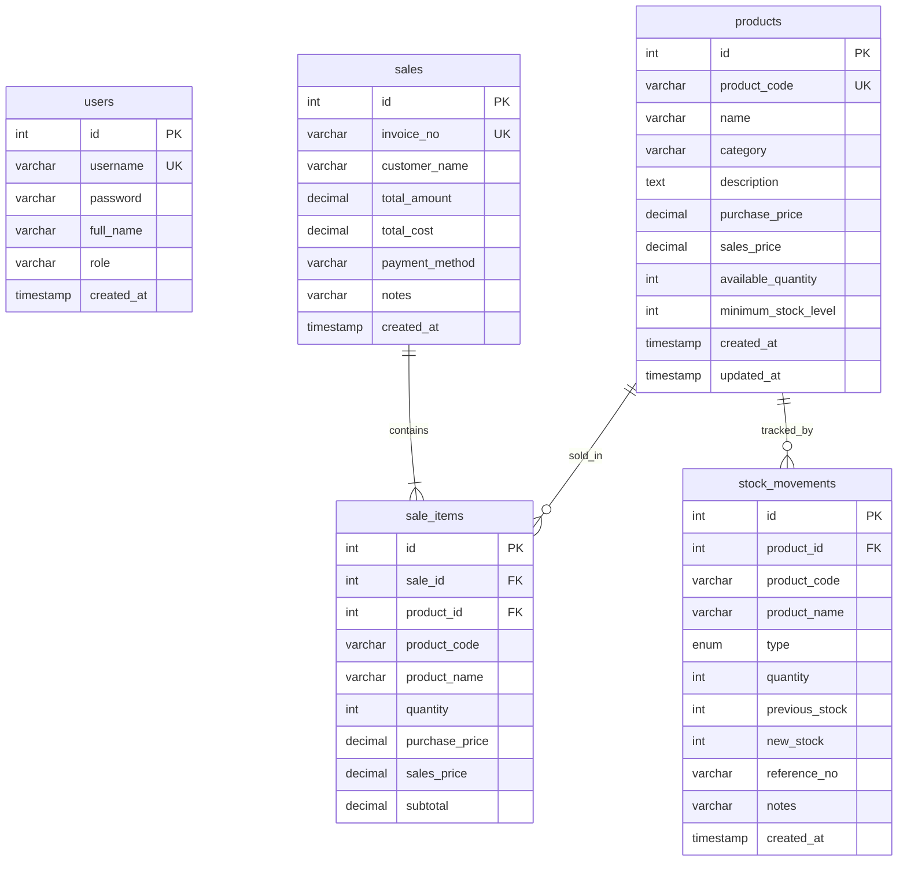
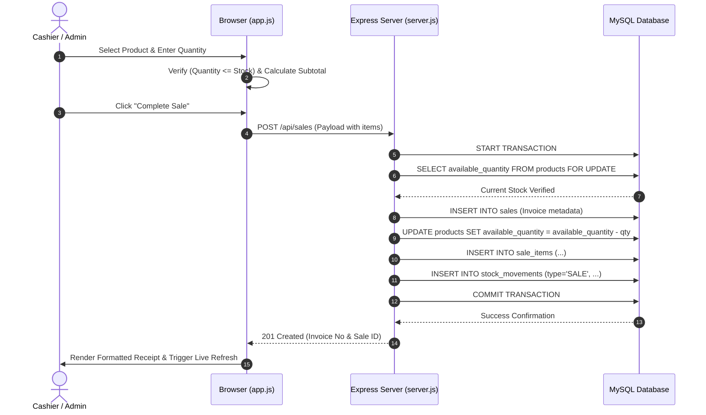

# Project Report: StockMaster – Inventory & Sales Management System

---

## 1. Executive Summary & Abstract

The **StockMaster Inventory & Sales Management System** is a full-stack, enterprise-ready web application developed to modernize and automate retail and warehouse inventory operations. Traditional inventory tracking approaches relying on physical ledgers or disconnected spreadsheets consistently suffer from data entry errors, lack of real-time stock synchronization, stockouts, and poor financial visibility.

StockMaster resolves these challenges through a lightweight, decoupled three-tier architecture:
1. **Presentation Layer**: Pure, performant **HTML5, modern CSS3, and Vanilla JavaScript (ES6+)** featuring native modal dialogs, real-time math computation, and dedicated `@media print` reports.
2. **Application Layer**: A high-concurrency **Node.js (Express)** REST API orchestrating business logic, authentication, automated stock calculations, and atomic transactions.
3. **Database Layer**: **MySQL Relational Database Management System (RDBMS)** enforcing referential integrity, row-level locking during checkout, and an immutable stock movement audit trail.

The system features user authentication, 8-attribute product catalog management, a point-of-sale sales terminal with automatic stock decrementing, and six specialized financial and analytical reports with date-range filtering and print optimization.

---

## 2. Introduction & Problem Statement

### 2.1 Background
Inventory management forms the core operational foundation of any retail, wholesale, or distribution business. Ensuring that inventory records faithfully mirror physical warehouse stock requires instant, error-free synchronization between sales operations and stock levels.

### 2.2 Problem Statement
Small-to-medium businesses frequently struggle with:
* **Over-reliance on Manual Ledgers / Disconnected Spreadsheets**: High error rates during manual entry and delay in reflecting sales.
* **Unmonitored Stockouts**: Running out of critical stock without prior warning, resulting in missed sales.
* **Lack of Margin & Valuation Insights**: Difficulty determining real-time stock valuation ($\sum \text{Quantity} \times \text{Purchase Price}$) versus retail valuation ($\sum \text{Quantity} \times \text{Sales Price}$).
* **Bloated Software Solutions**: Bulky enterprise resource planning (ERP) packages that require steep learning curves, excessive computational overhead, and high subscription fees.

### 2.3 Proposed Solution
StockMaster provides a responsive, zero-framework, single-page application (SPA) backed by a relational MySQL engine. It automates inventory updates at point-of-sale, tracks purchase costs against retail prices, and gives business owners immediate operational metrics on inventory health.

---

## 3. System Requirements Specification (SRS)

### 3.1 Hardware Requirements
* **Server-side**:
  * Processor: Dual-core 1.8 GHz or higher
  * Memory: 2 GB RAM minimum (4 GB recommended)
  * Storage: 500 MB free hard disk space
* **Client-side**:
  * Any computing device (Desktop, Laptop, Tablet, Mobile) with modern browser support
  * Minimum resolution: $360 \times 640$ (Mobile), $1280 \times 720$ (Desktop)

### 3.2 Software Requirements
* **Operating System**: Cross-platform (Windows 10/11, Ubuntu/Debian Linux, macOS)
* **Backend Runtime**: Node.js v18.0.0 or higher
* **Database**: MySQL Server 8.0 or MariaDB 10.4+
* **Web Browser**: Google Chrome, Mozilla Firefox, Microsoft Edge, or Apple Safari (Baseline Widely Available standard)

### 3.3 Functional Requirements
1. **User Authentication**: Secure sign-in mechanism checking hashed credentials against the database with persistent session state.
2. **Product Management**: Ability to create, read, update, and delete (CRUD) products across 8 key attributes: `Product Code`, `Name`, `Category`, `Description`, `Purchase Price`, `Sales Price`, `Available Quantity`, and `Minimum Stock Level`.
3. **Sales Processing**: Real-time sales transaction register validating requested quantities against on-hand stock, computing live invoice totals, and generating timestamped invoices.
4. **Automated Stock Synchronization**: Atomic database transactions that reduce `available_quantity` and append a corresponding `SALE` record into `stock_movements`.
5. **Business Reporting**: On-demand generation of Product Catalogs, Stock Valuations, Low Stock Alerts, Daily Sales, Monthly Sales, and Stock Audit Trails, filterable by date range and printable without UI clutter.

### 3.4 Non-Functional Requirements
* **Data Integrity**: Enforced via Foreign Key constraints (`ON DELETE CASCADE`) and InnoDB ACID compliance.
* **Performance**: Sub-100ms API response latency for search, catalog queries, and invoice creation.
* **Reliability & Concurrency**: Connection pooling (`connectionLimit: 10`) and row-level locking (`FOR UPDATE`) preventing race conditions during simultaneous sales checkouts.
* **Simplicity & Usability**: Clean visual hierarchy, zero compilation build steps for frontend assets, and keyboard-accessible native dialogs.

---

## 4. System Architecture & Design

### 4.1 High-Level Architecture Diagram

```mermaid
flowchart TD
    subgraph Client["Client Tier (Web Browser)"]
        UI["HTML5 UI / Responsive Views"]
        JS["app.js (Vanilla ES6+ Controller)"]
        Print["Print Engine (@media print)"]
    end

    subgraph Server["Application Tier (Node.js & Express)"]
        Router["Express HTTP Router (:3000)"]
        AuthMiddleware["Auth & DB Status Middleware"]
        Controller["Business Logic & Route Handlers"]
        Pool["mysql2 Connection Pool"]
    end

    subgraph Database["Data Tier (MySQL Server 8.0)"]
        UsersTbl[("users")]
        ProductsTbl[("products")]
        SalesTbl[("sales")]
        SaleItemsTbl[("sale_items")]
        MovementsTbl[("stock_movements")]
    end

    UI <-->|DOM Events / Fetch API| JS
    JS -->|JSON Payloads over HTTP| Router
    Router --> AuthMiddleware
    AuthMiddleware --> Controller
    Controller <-->|ACID Transactions| Pool
    Pool <-->|TCP Port 3306| Database
    JS -->|window.print()| Print
```

### 4.2 Entity-Relationship (ER) Diagram



### 4.3 Data Flow Diagram (DFD Level 1 - Sales Checkout)



---

## 5. Database Schema & Data Dictionary

### Table 1: `users`
Stores authenticated users and system administrators.

| Column | Data Type | Nullable | Key | Default | Description |
|---|---|---|---|---|---|
| `id` | INT | No | PK, AI | - | Unique system user ID |
| `username` | VARCHAR(50) | No | UNIQUE | - | Login account identifier |
| `password` | VARCHAR(255) | No | - | - | SHA-256 hashed password string |
| `full_name` | VARCHAR(100) | No | - | - | User display name |
| `role` | VARCHAR(50) | Yes | - | 'Admin' | Permission role (Admin/Staff) |
| `created_at` | TIMESTAMP | Yes | - | CURRENT_TIMESTAMP | Account creation timestamp |

### Table 2: `products`
The core catalog table holding stock levels, pricing, and alert thresholds.

| Column | Data Type | Nullable | Key | Default | Description |
|---|---|---|---|---|---|
| `id` | INT | No | PK, AI | - | Primary internal numeric key |
| `product_code` | VARCHAR(50) | No | UNIQUE | - | Business Product ID (e.g. `PRD-1001`) |
| `name` | VARCHAR(150) | No | - | - | Title of the product |
| `category` | VARCHAR(100) | No | INDEX | - | Classification category |
| `description` | TEXT | Yes | - | NULL | Product details and specifications |
| `purchase_price` | DECIMAL(10,2) | No | - | 0.00 | Wholesale cost price (in ₹) |
| `sales_price` | DECIMAL(10,2) | No | - | 0.00 | Retail selling price (in ₹) |
| `available_quantity` | INT | No | - | 0 | Current on-hand stock count |
| `minimum_stock_level`| INT | No | - | 5 | Threshold for low stock warning |
| `created_at` | TIMESTAMP | Yes | - | CURRENT_TIMESTAMP | Catalog entry timestamp |
| `updated_at` | TIMESTAMP | Yes | - | CURRENT_TIMESTAMP | Automatic update timestamp |

### Table 3: `sales`
Master invoice records generated upon checkout.

| Column | Data Type | Nullable | Key | Default | Description |
|---|---|---|---|---|---|
| `id` | INT | No | PK, AI | - | Unique sale record ID |
| `invoice_no` | VARCHAR(50) | No | UNIQUE | - | Invoice code (`INV-YYYYMMDD-XXXX`) |
| `customer_name` | VARCHAR(100) | Yes | - | 'Walk-in Customer' | Name of purchaser |
| `total_amount` | DECIMAL(10,2) | No | - | 0.00 | Total customer payment |
| `total_cost` | DECIMAL(10,2) | No | - | 0.00 | Cost of goods sold (COGS) |
| `payment_method` | VARCHAR(50) | Yes | - | 'Cash' | Cash, UPI / QR, Card, Net Banking |
| `notes` | VARCHAR(255) | Yes | - | NULL | Internal sale notes |
| `created_at` | TIMESTAMP | Yes | INDEX | CURRENT_TIMESTAMP | Transaction timestamp |

### Table 4: `sale_items`
Itemized line items associated with each master sale.

| Column | Data Type | Nullable | Key | Default | Description |
|---|---|---|---|---|---|
| `id` | INT | No | PK, AI | - | Itemized record ID |
| `sale_id` | INT | No | FK | - | Foreign key to `sales(id)` |
| `product_id` | INT | No | FK | - | Foreign key to `products(id)` |
| `product_code` | VARCHAR(50) | No | - | - | Snapshot of Product ID at sale |
| `product_name` | VARCHAR(150) | No | - | - | Snapshot of Product Name at sale |
| `quantity` | INT | No | - | - | Units sold |
| `purchase_price` | DECIMAL(10,2) | No | - | - | Cost per unit at transaction time |
| `sales_price` | DECIMAL(10,2) | No | - | - | Retail price per unit at transaction time |
| `subtotal` | DECIMAL(10,2) | No | - | - | Calculated `quantity * sales_price` |

### Table 5: `stock_movements`
The immutable audit ledger capturing every intake, outbound sale, or manual adjustment.

| Column | Data Type | Nullable | Key | Default | Description |
|---|---|---|---|---|---|
| `id` | INT | No | PK, AI | - | Movement ID |
| `product_id` | INT | No | FK | - | Foreign key to `products(id)` |
| `product_code` | VARCHAR(50) | No | - | - | Product code |
| `product_name` | VARCHAR(150) | No | - | - | Product name |
| `type` | ENUM | No | - | - | `'PURCHASE'`, `'SALE'`, or `'ADJUSTMENT'` |
| `quantity` | INT | No | - | - | Count of units changed |
| `previous_stock`| INT | No | - | - | Quantity prior to operation |
| `new_stock` | INT | No | - | - | Resulting quantity after operation |
| `reference_no` | VARCHAR(100) | Yes | - | NULL | Associated Invoice # or PO # |
| `notes` | VARCHAR(255) | Yes | - | NULL | Reason or remarks |
| `created_at` | TIMESTAMP | Yes | INDEX | CURRENT_TIMESTAMP | Event timestamp |

---

## 6. Implementation & Modular Breakdown

### 6.1 Authentication Module
* **Client**: Renders a full-viewport modal overlay blocking unauthorized application access. Credential tokens are stored in browser `localStorage`.
* **Server**: `POST /api/auth/login` checks the provided credentials against the `users` table via SHA-256 hashing.
* **Security & Session Management**: Provides a one-click **Logout** action that wipes client state and redirects to the sign-in screen.

### 6.2 Product Management Module
* **Catalog Exploration**: Renders all product fields in a responsive, zebra-striped data table with dynamic badge styling:
  * Green (`In Stock`): $\text{Available Quantity} > \text{Minimum Stock Level}$
  * Amber (`Low Stock`): $0 < \text{Available Quantity} \le \text{Minimum Stock Level}$
  * Red (`Out of Stock`): $\text{Available Quantity} = 0$
* **Live Querying**: Multi-column text search debounced at 250ms with instant category filtering without page reloads.
* **Modal CRUD Operations**: Implemented using native `<dialog closedby="any">` elements supporting platform-native light-dismissal (click backdrop or `Esc` key to close).

### 6.3 Sales Management Module
* **Smart Point of Sale (POS)**: The product selector dynamically populates active products and surfaces live stock availability and retail price.
* **Interactive Mathematical Computation**: As the user adjusts quantities, the client calculates:
  $$\text{Total Invoice Amount} = \text{Quantity} \times \text{Sales Price}$$
* **Concurrency-Safe Stock Deduction**: Server applies row locks (`SELECT ... FOR UPDATE`) inside an explicit transaction (`START TRANSACTION` ... `COMMIT`). If concurrent purchases exceed stock, the operation rolls back with a clean $400$ error.
* **Instant Invoicing**: On transaction success, the system formats an official printable receipt dialog (`INV-YYYYMMDD-XXXX`).

### 6.4 Reporting & Analytics Module
Six dedicated analytical reports designed for business intelligence:
1. **Product Report**: Audits gross profit margins ($\text{Sales Price} - \text{Purchase Price}$) across every item.
2. **Available Stock Report**: Aggregates total items, inventory cost value, potential gross valuation, and projected profit.
3. **Low Stock Report**: Automatically computes inventory deficit ($\text{Minimum Level} - \text{Current Stock}$) and estimates reorder capital requirements.
4. **Daily Sales Report**: Aggregates daily transaction volume, total revenue, wholesale cost, and net profit.
5. **Monthly Sales Report**: Groups sales figures by calendar month (`YYYY-MM`).
6. **Stock Movement Audit Report**: Full historical traceability of every physical unit movement.
* **Print Engine**: Dedicated `@media print` rules strip away sidebars, headers, action buttons, and borders to generate black-and-white, print-ready documents.

---

## 7. Testing & Quality Assurance

### 7.1 Test Cases & Results

| Test Case ID | Test Scenario | Input Data | Expected Result | Actual Result | Status |
|---|---|---|---|---|---|
| **TC-01** | Admin Authentication | Username: `admin`, Pass: `admin123` | Valid credentials accepted; session initiated; dashboard displayed | User logged in; token stored | **PASS** |
| **TC-02** | Invalid Authentication | Username: `admin`, Pass: `wrongpass` | HTTP 401 Unauthorized; error message displayed | "Invalid username or password" shown | **PASS** |
| **TC-03** | Product Creation | Code: `PRD-2001`, Qty: 20, Cost: 100, Price: 150 | Product created; initial `PURCHASE` movement logged | Row inserted in `products` & `stock_movements` | **PASS** |
| **TC-04** | Duplicate Code Prevention | Add existing code `PRD-2001` | HTTP 409 Conflict error prevented | "Product ID already exists" shown | **PASS** |
| **TC-05** | Live Sales Calculation | Qty: 3, Sales Price: ₹599.00 | Client displays ₹1,797.00 in real time | Input updates immediately to ₹1,797.00 | **PASS** |
| **TC-06** | Stock Decrement on Sale | Current stock: 25. Sell 2 units | Available stock reduced to 23; Invoice generated | Stock updated to 23; sale recorded in DB | **PASS** |
| **TC-07** | Overselling Prevention | Current stock: 5. Attempt to sell 6 units | Sale rejected; database transaction rolled back | "Insufficient stock" error returned | **PASS** |
| **TC-08** | Data Persistence Check | Stop node server; restart `npm start` | All records remain intact in MySQL disk storage | Complete catalog and sales preserved | **PASS** |
| **TC-09** | Report Date Filtering | From: `2026-11-01`, To: `2026-11-15` | Displays only transactions within the window | Query filtered correctly by timestamp | **PASS** |
| **TC-10** | Print View Formatting | Trigger `window.print()` | UI controls, navigation, and sidebar hidden | Clean document rendered for printing | **PASS** |

---

## 8. Setup & Deployment Guide

1. **Database Setup**:
   Ensure MySQL Server 8.0 is running on port 3306. Execute the DDL script:
   ```bash
   mysql -u root -p < database/schema.sql
   ```
2. **Environment Configuration**:
   Configure credentials in `.env`:
   ```ini
   PORT=3000
   DB_HOST=localhost
   DB_PORT=3306
   DB_USER=root
   DB_PASSWORD=your_password
   DB_NAME=inventory_db
   ```
3. **Dependency Installation & Execution**:
   ```bash
   cd d:\download\inventory-management-system
   npm install
   npm start
   ```
4. **Accessing Application**:
   Navigate to `http://localhost:3000` on any web browser.

---

## 9. Conclusion & Future Enhancements

### 9.1 Conclusion
The **StockMaster Inventory & Sales Management System** succeeds in delivering a performant, dependency-lean, and visually clean inventory management tool. By coupling a native HTML5/CSS3/JavaScript frontend with a transactional MySQL engine via Node.js, the project provides real-time stock control, safeguards against overselling, and produces business reports with zero computational waste.

### 9.2 Future Scope
* **Barcode / QR Scanner Integration**: Leveraging the Web Camera API (`BarcodeDetector`) for automated point-of-sale scanning.
* **Role-Based Access Control (RBAC)**: Distinguishing fine-grained permissions between Cashiers, Store Managers, and Accountants.
* **Automated Low-Stock Email Alerts**: NodeMailer integration sending alerts to suppliers when stock levels hit critical thresholds.
* **Multi-Warehouse / Multi-Store Support**: Multi-tenant database schema partitioning stock by branch location.

---

*Report prepared and generated for the StockMaster Inventory Management Project.*
